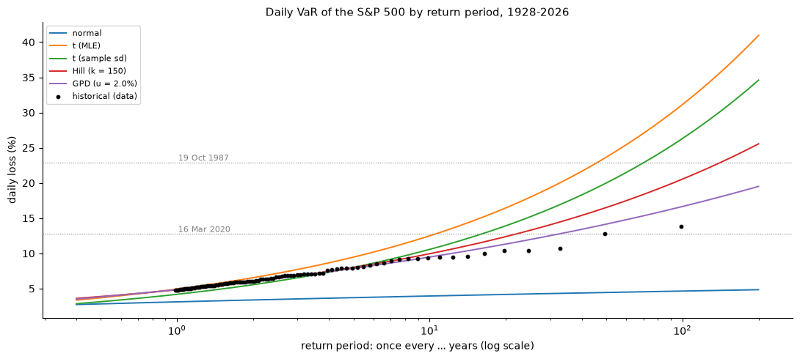
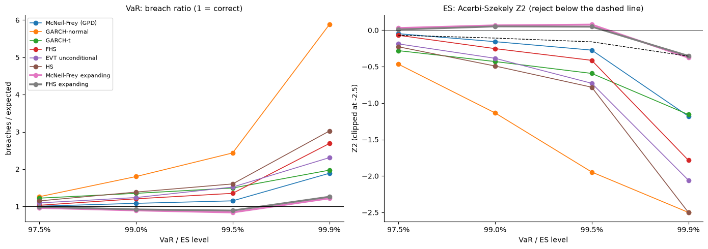

# Extreme Value Theory for Tail Risk: the S&P 500, 1928–2026

**How large can a one-day loss on the S&P 500 be at the 99.9% level and beyond — once in 10 or 100 years — and which model forecasts such losses reliably out of sample?**

This project estimates the extreme tail of **24,818 daily S&P 500 losses (January 1928 – October 2026)** with extreme value theory, and tests it out of sample over **23,818 days (December 1931 – October 2026)**. Everything is implemented from scratch in Python: the Hill estimator, peaks-over-threshold with the Generalized Pareto Distribution (GPD), VaR/ES and return levels against normal, Student-t and historical benchmarks, confidence intervals (delta method, profile likelihood, block bootstrap, coverage simulation), the extremal index, a GJR-GARCH filter by quasi-maximum likelihood, the **McNeil–Frey** conditional EVT model with five competitors, and four backtests (Kupiec, Christoffersen, exact binomial, Acerbi–Székely Z2).

Methods follow J. Daníelsson, *Financial Risk Forecasting* (Wiley, 2011), Chapter 9, with McNeil and Frey (2000), applied to current data.

---

## Executive summary

| | Result |
|---|---|
| **The tail** | GPD above a 2% daily loss (886 exceedances): **ξ = 0.191 ± 0.078** (tail index α ≈ 5). Hill gives 0.29–0.35 but is biased upwards in this sample. |
| **Unconditional extreme risk** | **VaR 99.9% = 7.38%, ES 99.9% = 9.95%** (USD 712k / 947k on USD 10m), within 3% of historical simulation. Normal: VaR −52%, ES −60%. Student-t (MLE): ES +45%. |
| **Beyond the data** | **Once-in-100-years daily loss: 16.7%** (95% profile-likelihood interval 13.6–21.8%). 19 October 1987 is a once-in-400-years day under the GPD. |
| **Uncertainty** | Delta-method intervals miss on the high side for long return periods (6% vs 1.7% for profile likelihood in 300 simulations); a 20-day block bootstrap widens intervals by 20–90%. |
| **Clustering** | Extremal index **0.51** (0.85 if shuffled). GJR-GARCH removes it (Ljung–Box on squares 12,201 → 25.1) but not the fat tail (residual ξ = 0.21). |
| **Out of sample** | Rolling McNeil–Frey is the best of six methods and passes Kupiec at 97.5–99.5%, but **every rolling method fails at 99.9%** (McNeil–Frey 45 breaches vs 23.8). |
| **The fix** | **Rolling GARCH volatility + residual tail estimated on all past residuals**: 99.9% breaches **45 → 29**, Kupiec p = 0.30, Christoffersen p = 0.57, Z2 borderline (−0.376 vs −0.356). Zero 99.9% breaches in autumn 2008 and spring 2020 (historical simulation: 11 and 7). |
| **Data quality** | Four mistyped closes (1935, 1935, 1936, 1961) found by a volatility-scaled reversal rule and removed. |



---

## Data and design

- **Data:** S&P 500 price index, Yahoo Finance `^GSPC`, daily closes from 30 December 1927; losses $x_t = -100\ln(S_t/S_{t-1})$ in % (positive = loss).
- **Data cleaning:** a reversed move larger than 6× the previous 60-day volatility is a data error; the bad close is dropped (`BAD_CLOSES`), never interpolated. Two passes.
- **Threshold:** u = 2% (lowest threshold with a linear mean excess function and stable ξ and β − ξu).
- **Out-of-sample engine:** 1,000-day window, GJR-GARCH(1,1) by QML refitted every 20 days, σ_t updated daily; six methods (McNeil–Frey, GARCH-normal, GARCH-t, FHS, unconditional EVT, historical simulation) at 97.5 / 99 / 99.5 / 99.9%; no look-ahead (tested).
- **Backtests:** Kupiec, Christoffersen, exact binomial, Acerbi–Székely Z2 with simulated critical values.

## Main results

| 99.9% (expected 23.8 breaches) | Breaches | Kupiec p | Christoffersen p | Z2 (crit. −0.356) |
|---|---|---|---|---|
| GARCH-normal | 140 | 0.000 | 0.000 | −6.39 |
| Historical simulation | 72 | 0.000 | 0.000 | −2.76 |
| FHS (rolling) | 64 | 0.000 | 0.000 | −1.78 |
| GARCH-t | 47 | 0.000 | 0.000 | −1.16 |
| McNeil–Frey (rolling) | 45 | 0.000 | 0.000 | −1.18 |
| **McNeil–Frey (expanding tail)** | **29** | **0.304** | **0.570** | **−0.376** |



## Repository structure

```
evt-tail-risk/
├── src/tailrisk/          data, descriptive, evt, benchmarks, garch, engine, backtest, plots
├── tests/test_tailrisk.py 32 unit tests (synthetic data, known answers, look-ahead)
├── notebooks/01_tail_risk.ipynb   43 numbered steps, 5 questions each, findings per section
├── notes/theory.md        theory notes, Equations 1–30
├── reports/               Project7_Report.docx, Project7_Theory_Notes.docx, figures/
└── data/raw, data/processed   created by the notebook (not committed)
```

## How to run

```bash
conda create -n quant python=3.12
conda activate quant
pip install -r requirements.txt
pytest -q                                 # 32 tests
jupyter lab notebooks/01_tail_risk.ipynb  # run top to bottom
```

The first run downloads the data and computes the out-of-sample engine (about 4 minutes), the bootstrap and the coverage simulation; results are saved in `data/processed` and reloaded afterwards.

## Limitations

One index (no portfolio or tail dependence); the threshold is a judgement (results stable for 1.5–3%); the 99.9% ES is borderline; Christoffersen rejects narrowly at 99–99.5% for the expanding method; early data may contain further small errors; price index only; one-day horizon.

## References

- Daníelsson, J. (2011). *Financial Risk Forecasting*. Wiley.
- McNeil, A. J. and Frey, R. (2000). Estimation of tail-related risk measures for heteroscedastic financial time series: an extreme value approach. *Journal of Empirical Finance*, 7, 271–300.
- Embrechts, P., Klüppelberg, C. and Mikosch, T. (1997). *Modelling Extremal Events for Insurance and Finance*. Springer.
- Acerbi, C. and Székely, B. (2014). Backtesting expected shortfall. *Risk*, December.
